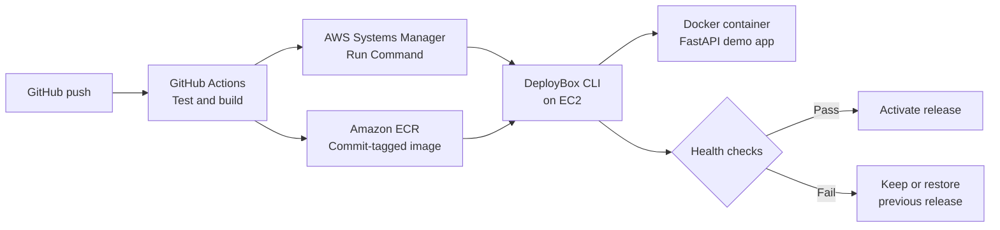

# DeployBox

A lightweight container deployment tool with health checks and rollback, built with Python, Docker, and AWS.

DeployBox is a portfolio project designed to take a Docker image, run it on a Linux server, verify its health, and recover the previous working release when a deployment fails. A small FastAPI application will demonstrate the complete release workflow.

> **Status:** Planning stage. This repository currently contains the [project guide](DeployBox_Project_Guide.md). The application, CLI, infrastructure, and automation described below are planned features.

## Project goals

- Build and publish Docker images tagged with an immutable Git commit SHA.
- Check a candidate container before switching the active release.
- Restore the previous release if the new version fails its live health check.
- Inspect the active version and container logs through a Python CLI.
- Automate releases with GitHub Actions and AWS Systems Manager.
- Provision AWS resources with Terraform.

The MVP targets **one application on one Linux server**. A brief interruption during release switching is acceptable. Zero-downtime deployments and multi-server orchestration are future improvements.

## Architecture



GitHub Actions will authenticate to AWS through OpenID Connect (OIDC). The EC2 instance will use an IAM role to access ECR and Systems Manager.

## Technology stack

| Component | Technology |
| --- | --- |
| Demo application | Python and FastAPI |
| Deployment tool | Python CLI calling Docker |
| Container runtime | Docker |
| Image registry | Amazon ECR |
| Server | Amazon EC2 running Linux |
| CI/CD | GitHub Actions |
| Remote deployment | AWS Systems Manager Run Command |
| Infrastructure as code | Terraform |

## Planned CLI

These commands describe the intended interface and are not available yet.

```bash
# Deploy an image after checking its health
deploybox deploy IMAGE

# Show the active image, previous image, and health
deploybox status

# Show recent logs from the active container
deploybox logs

# Health-check and deploy the previous successful image
deploybox rollback
```

DeployBox will track active and previous image references in a state file, with a configurable state directory for local development and EC2.

## Release behavior

1. Verify Docker availability and validate the image reference. Pull registry images as needed.
2. Start a candidate container on a separate port bound to `127.0.0.1`.
3. Poll its `/health` endpoint until it passes or a fixed timeout expires.
4. Reject an unhealthy candidate and leave the active application running.
5. For a healthy candidate, switch the live container to the new image and check health again.
6. Restore the previous image if the live check fails. Update saved release state only after a successful deployment.

Failed deployment commands will return a nonzero exit code so the pipeline can report failures.

## Demo application

The demo service will expose two endpoints:

| Endpoint | Expected behavior |
| --- | --- |
| `GET /` | Return the service name and version from `APP_VERSION`. |
| `GET /health` | Return HTTP 200 when ready, or HTTP 503 when `FAIL_HEALTH=1`. |

The container will listen on port `8000`, published locally on port `8080`. The failure switch will make it possible to demonstrate rejection of an unhealthy release.

## Getting started

Start with the milestones in the [DeployBox project guide](DeployBox_Project_Guide.md).

Follow the [Milestone 1 step-by-step guide](docs/milestone-1-demo-app.md) to build, test, and run the demo application locally and in Docker.

For local development, prepare Python, Git, Docker, and `curl`. Terraform, the AWS CLI, and an AWS account will be needed for the infrastructure milestone. Runnable installation and deployment instructions will be added as each component is implemented.

### Planned repository layout

```text
deploybox/
├── demo-app/                 # FastAPI service, Dockerfile, and app tests
├── deploybox/                # CLI, Docker runtime, and release state
├── tests/                    # Deployment tool tests
├── infra/                    # Terraform configuration
├── .github/workflows/        # Test, build, publish, and deploy workflow
├── docs/                     # Architecture and recovery documentation
├── DeployBox_Project_Guide.md
└── README.md
```

## Roadmap

- [ ] Prepare the workspace and verify local tools.
- [ ] Build and test the demo application, including its failure switch.
- [ ] Implement local deployment, status, logs, and rollback commands.
- [ ] Provision ECR, EC2, IAM roles, and networking with Terraform.
- [ ] Deploy an image manually to EC2.
- [ ] Automate tests, image publication, and deployment with GitHub Actions.
- [ ] Document setup, recovery, and cleanup; capture demonstration evidence.

### Acceptance demonstration

Deploy a healthy `v1`, reject an unhealthy `v2` while `v1` continues serving requests, deploy a fixed `v3`, and manually roll back to `v1`. The failed deployment must also cause the GitHub Actions workflow to fail.

## AWS setup and cleanup

The planned environment uses one ECR repository and one EC2 instance in a single AWS Region. The workflow and instance will have separate IAM permissions, and the deployment workflow will use Systems Manager without requiring inbound SSH access.

Keep credentials and private keys out of the repository and logs. Before provisioning, check your account's credits and eligibility and configure a budget alert. Cleanup instructions will accompany the Terraform implementation; destroy the practice environment when it is no longer needed, after preserving any demonstration evidence.

## Future improvements

- Blue/green deployments behind a reverse proxy.
- A read-only deployment history page.
- CloudWatch logs and alerts for repeated deployment failures.
- Integration tests using real containers and intentional health failures.
- Support for a second demo application.
